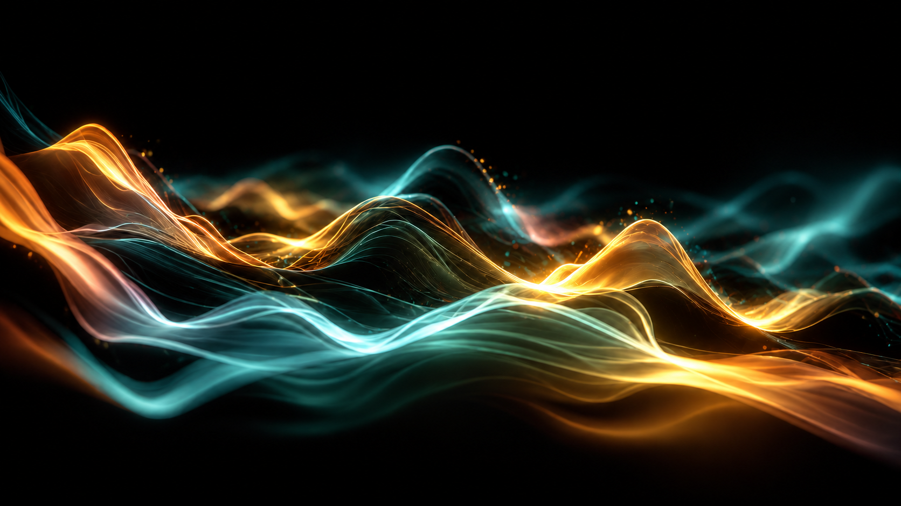

# REQ-007 — SONORA Live Focus & Universe V3: flowing light-ribbon soundscape

**Status:** Accepted by Sven on 2026-10-25 — delivered product/device scope; see [acceptance record](../release/device-acceptance-2026-10-25.md). Remaining release work and new review findings: REQ-011.
**Date:** 2026-10-24
**Priority:** P0 — signature artwork quality
**Difficulty:** High (9/10), app navigation/state integration + procedural Skia visual tuning
**Recommended Claude Code:** **Opus 5.5, High effort** for V3 composition/renderer; **Sonnet 5.5, Medium** for small follow-up tuning. If Opus quota/time is tight, Sonnet 5.5 High is a reasonable alternative.
**Timebox:** ~75–95 minutes (15–25 minutes navigation, 55–70 minutes artwork), plus physical-device review
**Target:** iPhone 13 Pro Max portrait first; shared React Native/Skia implementation for iOS and Android
**Depends on:** REQ-005 Universe V2 (`src/viz/universePainter.ts`, `vizModel.ts`) and the existing REQ-006 immersive UI

## Product decision and current-code finding

Sven's current prototype decision is **one Live screen, a discreet Settings access, and immersive fullscreen**. **No bottom navigation, no visible Sound Walk or Gallery**; those concepts are deferred, not “Coming soon” destinations.

REQ-006's revised *document* already requested this, but **the new implementation commit `aa5e6a8` still renders `TabBar` and the `walk`/`gallery` `ComingSoonScreen` branches in `App.tsx`** (verified when drafting REQ-007). That commit did add the immersive artwork, honest sound tile, icons and polish. **REQ-007 must close this implementation gap while preserving the good REQ-006 work**, then deliver the Universe V3 artwork.

## P0-A — Single-purpose Live / Settings navigation (first)

1. Replace `App.tsx`'s four-tab state with a simple `'live' | 'settings'` view state. Root is **Live**. Remove the **bottom tab bar entirely**, including its safe-area spacer; **Sound Walk** and **Gallery** must not appear in Live, Settings, shortcuts or immersive overlays. Do not implement those postponed features or delete unrelated user data.
2. Put a polished settings **gear button** at the **upper-right of the Live header**, balancing SONORA / “Visualize Your Surroundings”. Touch target >=44 pt, accessible “Open settings”, clear pressed/focus state, legible in Dark/Light and large text. Keep an always-truthful microphone status visible without cluttering the header.
3. `SettingsScreen` becomes a true secondary view, with title **Settings** and a clear **Back to Live** control top-left; hardware Back on Android returns to Live. **No navbar in either view.** Listening toggle, Appearance, Visualization, Diagnostics and About remain in Settings, not Live.
4. Keep `SessionProvider` **above** view switching. Preserve the existing microphone capture, current recognition, event timeline and one `SoundCanvasView` state when opening Settings and returning; hide/pause the Live canvas while Settings is shown without unmounting/reinitializing it or creating duplicate frame loops. Background app behavior is unchanged.
5. Preserve REQ-006 immersive mode: its **Expand artwork** button is distinct from Settings gear; entry/exit, pure-art/sounds overlays and Android Back remain functional. Entering immersion must show the **same** current Universe; the bottom tab bar cannot reappear on exit.
6. Reuse existing shared icons/tokens; no new native UI dependencies. Safely retire `TabBar.tsx` and `ComingSoonScreen.tsx` from active imports. Remove dead files only if no references remain. Update copy that calls Settings a “tab”.
7. Add focused navigation state tests where practical (Live ↔ Settings, Android Back priority, open Settings while listening, immersive exit). Do not modify YAMNet, native audio or recognition semantics.

## Attached V3 concept artwork

**Source of inspiration:** Sven's supplied image: elegant orange/amber and aqua/teal translucent light waves against almost-black space. The linked V3 concept artwork is a polished composition reference generated from that visual direction. It establishes **shape, depth, color balance and atmosphere**, **not** a PNG to use as a fake animated or static canvas background.

### Desired visual identity

- **Signature form:** A broad continuous landscape of luminous, interwoven **silk/light ribbons** running horizontally through the lower and middle region; elegant crests and troughs at different depths. This should read like living sound, **not** a radar, galaxy icon, mountain silhouette, sine-wave graph or audio equalizer.
- **Composition:** At wide aspect ratios, reserve roughly the upper 25–40% for quiet dark/negative space; flowing ribbons occupy and overlap much of the middle and lower frame. In portrait card/fullscreen, **re-compose to actual dimensions**, prioritizing visible curves and not cropping the entire subject. No fixed 16:9 bitmap stretching.
- **Materials and depth:** 3–5 distinct translucent flowing sheets or principal strands with a bounded number of very fine, hairline highlights; luminous edges, soft selective glow, semitransparent folds, overlapping cool foreground/warm middle/background layers, subtle haze only around the ribbons. A few tiny motes drift near crests. Avoid solid filled strips, harsh polygons, many orbiting spheres, big centered halo/opaque rings, and overbright fog covering the whole canvas.
- **Palette — Dark default:** near-black/deep-navy void, aqua/cyan/teal and warm amber/gold as the dominant complementary colors; small cream-white highlights. Lavender can provide a **subtle event-specific accent**, not a blanket purple wash. Maintain SONORA branding and existing Dark tokens where practical.
- **Palette — Light:** an equally **designed** pearl/lilac background with deeper turquoise, soft honey-gold and restrained lavender ribbon edges. Keep depth, separation and visible light effects; do not put a big black rectangle on a light app screen, and do not simply invert the Dark art.
- **Mood:** premium, serene, organic, artistic and responsive. Slow, silky movements between sound events; highly legible UI controls remain outside/above the decorative art.

## P0-B — Actually reactive V3 animation

Use the **existing** `VizState` and its ambient-adapted feature stream. The image is a guide for the procedural renderer, **never a substitute** for real sound-driven geometry.

1. **Continuous ribbon surface.** Develop the V2 `UniversePainter.ribbons()` idea into a layered landscape: smoothly evolving Bezier/Skia paths or similarly inexpensive ribbons with coherent motion along their lengths. Use stable seeds/phase offsets and normalized coordinates; no random reseeding or topology popping each frame.
2. **Sound energy drives shape**, not just opacity. On a genuine short foreground onset (`accent`/`bursts`), locally lift one or more crests, broaden a glowing edge, send a smooth travelling deformation through the strands, and release gracefully. Use `level` and existing relative baseline so a quiet voice in a quiet room is visible, while constant traffic/fan noise eventually settles. No sound => beautifully quiet, almost static artwork.
3. **Frequency bands matter:** low energy can broaden slow lower sheets, mid can bend main crests, high can brighten fine filaments and a few glints. Each effect should be bounded, filtered and tied to real `bands`, not appear continually in silence. Keep category recognition separate from audio energy.
4. **Recognized categories alter the artistic accent** without pretending detection where none occurred: speech gently introduces lavender-laced wave strands; rain adds small mint/gold drift; bell/dog bark/applause energize a brief gold edge/glint wave; music layers organic modulation from bands; unknown/silence is a neutral calm composition. Use only existing `Motif`/real `SoundCategory` mappings, gentle crossfades and no synthetic user-facing detections.
5. **No misleading spatialization:** curved ribbon positions are artistic, not microphone-derived sound directions, distances or localizations.
6. **Respect capture states:** when the microphone is off, animations settle without false events. Keep visualization modes **Animated / Reduced / Off**, system Reduced Motion, foreground/background pause, and existing accessibility semantics. Reduced gives a stable beautiful frame with very restrained or no motion; Off draws no artwork but preserves classifications and sound labels.

## P0 — Implementation approach / quality

- Focus on `src/viz/universePainter.ts`, making carefully scoped changes to `src/viz/vizModel.ts` only where sound-driven motion demands it. The current `SoundCanvasView.tsx` already swaps one `SkPicture`; keep its **single-canvas** lifecycle and REQ-006 immersive sizing/pause behavior.
- Reuse Skia paints, shaders, cached background and seeded geometry; keep count of paths, alpha layers, glow passes and particles **bounded**. Avoid per-frame React subtrees, raster image/video backgrounds, unbounded array/object churn, an extra animation loop, and additional native dependencies. Monitor `SkPicture` garbage collection in longer sessions.
- Maintain the current ~30 fps animated target and existing reduced/idle throttling unless profiling justifies a change. Prefer a slightly simpler smooth composition to a laggy photoreal imitation of the concept.
- Recompute paths/surface layout from actual canvas dimensions so Live artwork card and immersive fullscreen share the **same** logical scene (REQ-006), with no cropped ribbons, stretching, black bands or reset on expand/exit.
- Compare Dark/Light headless Skia captures **and** real iPhone screenshots against the concept image. If visual fidelity proves too ambitious in one sprint, prioritize: (1) layered continuous teal/gold ribbons; (2) real sound-deformed crests; (3) refined glow/filaments; (4) sparse motes. Record honest limitations.
- Preserve native audio, YAMNet model, classification thresholds, timeline and user-facing microphone truth. Do not add Sound Walk, Gallery, saving/export, custom shader/native module, art-style selector or new detection categories.

## Acceptance checklist

- [ ] From launch there is exactly one main **Live** view; **no bottom tab bar, Sound Walk or Gallery** visible/reachable. Settings gear opens a polished secondary view with Back to Live; Start/Stop and Appearance stay in Settings.
- [ ] Live ↔ Settings and Android Back preserve microphone session, event timeline and artwork state; immersive mode still works with exactly one microphone and one active renderer loop.
- [ ] In Dark, the V3 composition looks recognizably inspired by the committed design reference: **flowing semi-transparent cool/warm ribbon landscape**, delicate luminous edges, controlled overlapping depth and calm negative space — not radial bullseye, three circles, generic stars or straight audio bars.
- [ ] In Light, the artwork has an intentionally adapted pearl/turquoise/gold composition and does not become a black-backed screenshot.
- [ ] Quiet room: slow beautiful motion; a quiet speech/tap onset causes observable short-lived ribbon deformation, not brightness change alone.
- [ ] Sustained noise: the scene settles via the existing relative baseline; a new stronger event remains visible.
- [ ] Speech / rain / bell-or-applause / music render distinguishable accents **when genuinely recognized**; unknown/silence creates no fictitious category.
- [ ] Sound OFF, permission denied, app background, Reduced Motion and Visualization Off never misrepresent listening or keep needless work running.
- [ ] Normal Live card and immersive portrait fullscreen both show an intentional, uncropped composition; expand/exit does not reset sound session, event history or spawn extra painters.
- [ ] No obvious dropped frames, jank or thermal runaway over a 5–10 minute physical iPhone session; report tested FPS/memory/thermal observations where measurable and clearly label estimates.
- [ ] `npm run typecheck` and `npm test` pass; extend pure visualization-model tests for silence, onset, sustained noise, band changes and finite/bounded geometry as appropriate.
- [ ] Provide **actual screenshots** (not only the generated reference): Dark Live, Light Live, Dark Immersive, plus a short description/video of motion during real sound. Explicitly mark anything not tested on device.

## Handoff to Claude Code

1. Read REQ-005, the updated REQ-006 and current `App.tsx`; verify the actual current branch. First surgically remove leftover four-tab navigation while preserving REQ-006's implemented immersive UI.
2. Use `docs/design/sonora-universe-v3-concept.png` as the visual north star. **Recreate its aesthetic in real-time Skia** with genuine sound-driven movement, not by painting the PNG behind a few particles.
3. Keep the first pass within the timebox; inspect actual output, refine one major mismatch, run automated tests, and report a concise iPhone test checklist and unresolved performance issues.

**Implementation stop:** Commit the focused Live/Settings navigation, responsive V3 renderer and tests. Do not expand this sprint into Sound Walk, Gallery or unrelated features.
